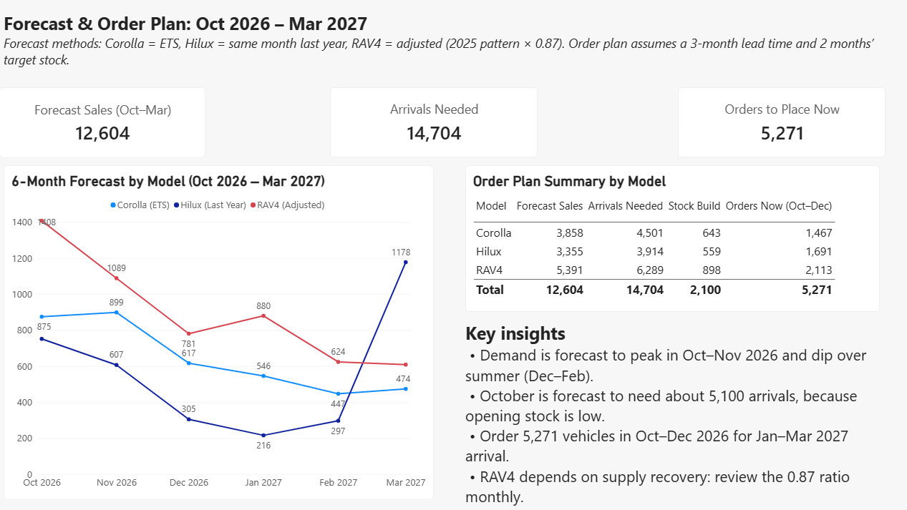
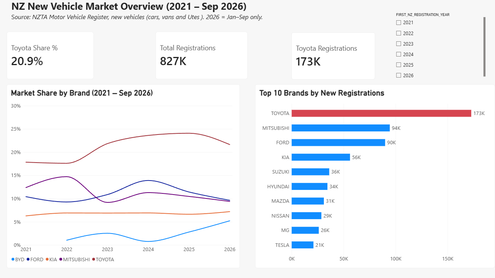
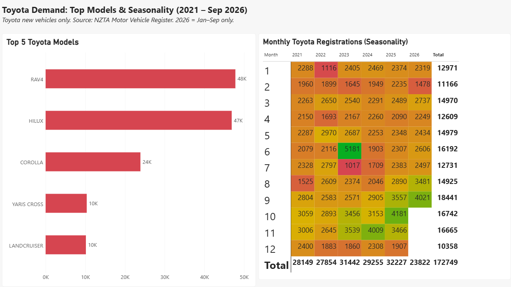

# NZ Vehicle Demand Forecast & Order Plan

**A 6-month sales forecast and order plan for Toyota's top 3 models in New Zealand. Built in Excel and Power BI from public NZTA data.**

> Independent portfolio project. It is not linked to Toyota New Zealand and uses no internal Toyota data. Stock levels and lead times are assumptions.

---

## In 30 seconds

- **Forecast:** 12,604 RAV4, Corolla and Hilux sales from October 2026 to March 2027
- **Tested before use:** each forecast method was tested on 6 months of real sales, and the most accurate method was chosen for each model (error 16.6%–28.6%)
- **Order plan:** 14,704 vehicles need to arrive. **5,271 should be ordered now** to arrive in January–March 2027
- **Key insight:** RAV4 sales fell in 2026 because of **limited supply, not low demand**, so I adjusted the forecast rather than copying the dip

---

## The business problem

A distributor orders new vehicles about **3 months before they arrive**. Too few, and customers wait or buy another brand. Too many, and money is tied up in stock. The planner's job is to get the right number of vehicles here at the right time.

This project answers 4 questions a supply and demand team asks every month:

1. **Market:** How is Toyota performing against competitors?
2. **Demand:** Which models sell most, and in which months?
3. **Forecast:** How many RAV4, Hilux and Corolla will sell in the next 6 months, and how accurate is the forecast?
4. **Supply:** How many vehicles should be ordered, and by when?

---

## How this project matches the Forecast Analyst role

| What the role needs | What I did in this project |
|---|---|
| Sales forecasting | Built 6-month forecasts by model with FORECAST.ETS and seasonal methods |
| Forecast accuracy | Measured error (MAPE) on held-back months and compared against a simple benchmark |
| Supply and stock planning | Built a stock-flow model with lead time, target stock and order dates |
| Strong Excel skills | Power Query, PivotTables, FORECAST.ETS, EDATE, linked formulas, what-if inputs |
| Market understanding | Tracked market share, competitor growth (BYD) and policy effects (Clean Car Discount) |
| Clear reporting | 3-page Power BI dashboard and plain-English recommendations |
| Good judgement | Spotted that 2026 RAV4 data showed a supply gap, and adjusted the forecast |

---

## Findings

### Q1. Market share
- Toyota is the clear market leader. Its share grew from **17.9% (2021) to 24.1% (2025)**, then fell to **21.6% in Jan–Sep 2026**.
- The 2026 fall came from the **RAV4 only**, during its model change. Toyota's other models sold more than in the same months of 2025.
- **BYD** is the fastest-growing competitor, rising to **5.2%** share in 2026.

### Q2. Top models and seasonality
- The top 5 models make up **80.5%** of Toyota sales. RAV4 and Hilux alone make up **55%**, so planning these two well matters most.
- Sales peak in **October and November** and are lowest in **February and December** (2021–2025 average).
- One-off months were marked so they don't distort the pattern: the August 2021 lockdown and the June 2023 rush before Clean Car fees went up.

### Q3. Forecast (Oct 2026 – Mar 2027)

| Model | Method chosen | Error (MAPE) | 6-month forecast |
|---|---|---|---|
| RAV4 | 2025 pattern, adjusted (× 0.87) | 23.8% | 5,391 |
| Corolla | FORECAST.ETS | 28.6% | 3,858 |
| Hilux | Same month last year | 16.6% | 3,355 |
| **Total** | | | **12,604** |

- **RAV4 adjustment:** Jan–Mar 2026 sales were low because the old model was running out, not because buyers lost interest. I used the 2025 monthly pattern × 0.87, the current sales level with the new model.
- **RAV4 range:** about 4,650 if supply gets worse, about 6,200 with full supply.

### Q4. Order plan
Assumptions: 3-month lead time, target stock of 2 months' sales, low opening stock after the 2026 shortages.

| Model | Forecast sales | Arrivals needed | Order now (Oct–Dec 2026) |
|---|---|---|---|
| RAV4 | 5,391 | 6,289 | 2,113 |
| Hilux | 3,355 | 3,914 | 1,691 |
| Corolla | 3,858 | 4,501 | 1,467 |
| **Total** | **12,604** | **14,704** | **5,271** |

- 14,704 arrivals = 12,604 for sales + 2,100 to rebuild stock.
- **October is the pressure point**, needing about 5,100 arrivals because stock is low going into the peak.
- Lead time and target stock are input cells. Change one, and the whole plan and the order dates update.

---

## How I made sure the numbers can be trusted

- **Data check:** my 2025 total matched **96.9%** of NZTA's official figure. The small gap is vehicles that have since been deregistered.
- **Backtest:** I trained each method on Jan 2021–Mar 2026 and tested it on Apr–Sep 2026, which it had not seen.
- **Benchmark:** a method is only used if it beats "same month last year".
- **Watch points:** the Corolla forecast may be lifted by a one-off fleet spike in September 2026, and Hilux March 2027 copies an unusually high March 2026. Both should be checked as actual sales come in.

---

## Recommendations

1. **Prioritise RAV4 supply.** Sales are limited by supply, not demand. Review the 0.87 ratio every month as supply improves.
2. **Build stock before spring.** Order October stock by July, and order less for December to February.
3. **Place about 5,271 orders now** for January–March 2027, and track BYD's growth in monthly reports.

---

## What I would do with internal Toyota data

Public registrations show what was **supplied**, not what customers wanted. With internal data I would:

- Use **order books and waiting lists** to measure true demand
- Separate **fleet and rental orders** from retail sales to reduce forecast error
- Replace the assumed lead time and stock with **real shipping schedules and dealer stock**
- Track **forecast vs actual** every month and improve the methods over time

---

## Files

- `toyota_nz_new_registrations_2021_2026.xlsx`: cleaned data and the Excel analysis for Q1–Q4
- `Toyota_NZ_Dashboard.pbix`: Power BI dashboard (open with Power BI Desktop)
- `images/`: dashboard screenshots

---

## About me

I'm **Susmita Kumari Giri**, a data and business analyst based in Hamilton, New Zealand.

- **Master of Digital Business** (AI and Business Analytics), University of Waikato, First Class Honours
- **MBA in Finance**, Tribhuvan University
- Skills: Excel (Power Query, forecasting), Power BI, SQL, data analysis and reporting
- Open to relocation within New Zealand

I built this project to show how I would approach demand forecasting and supply planning: test the numbers, question what the data really shows, and turn the analysis into clear actions.

📧 Sushmitagiri754@gmail.com · [LinkedIn](https://www.linkedin.com/in/susmita-kumari-giri)
